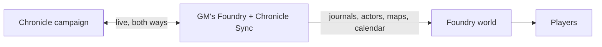

<h1 align="center">Chronicle Sync</h1>

  <b>Your <a href="https://github.com/keyxmakerx/Chronicle">Chronicle</a> campaign and your Foundry VTT world, kept in step both ways.</b> 
  Journals, maps, characters, items, shops and the calendar, live while you play.

  
  

Write in Chronicle between sessions and run the game in Foundry. Chronicle Sync runs in the GM's Foundry client and keeps the two in step: a change on either side shows up on the other, and journals, characters, inventories and map items catch up on what changed while Foundry was closed. Players never need a key of their own.

## What it syncs

<table>
  <tr>
    <td width="50%" valign="top">
      <b>Journals</b> 
      Chronicle pages become Foundry journal entries. GM-only text and pictures stay hidden from players who don't own the page, and nothing is deleted without asking.
    </td>
    <td width="50%" valign="top">
      <b>Maps</b> 
      Chronicle maps open in Foundry with their markers, drawings, tokens, layers and fog. Players see the smudged picture of a shadowed map, and the GM can hand a map to a character.
    </td>
  </tr>
  <tr>
    <td width="50%" valign="top">
      <b>Characters, creatures and items</b> 
      Actors and character pages map field by field for D&amp;D 5e, Pathfinder 2e, Draw Steel, or any system whose fields are annotated. Draw Steel creatures arrive as NPC actors.
    </td>
    <td width="50%" valign="top">
      <b>Calendar and the Sky Clock</b> 
      Chronicle's date, weather, season, era and moons, with no Foundry calendar module needed. Show it as a thin strip or as the Sky Clock, a glass globe holding the world's sky.
    </td>
  </tr>
  <tr>
    <td width="50%" valign="top">
      <b>Shops, stashes and crafting</b> 
      Chronicle's shop rooms open in Foundry, and players buy with the character they pick. Stashes move items and money between characters, with the GM approving requests from a chat card. Each hero's crafting (spoils to take, harvest or study, and projects to roll) sits in the Satchel.
    </td>
    <td width="50%" valign="top">
      <b>DM Screen, notebook and NPCs</b> 
      The GM's DM Screen in a Foundry window, each player's own journal and jot notes, spotlight, talking glow and open page for NPC tokens, a token's full art beside the cursor when you hover it, and Change form for creatures with more than one form.
    </td>
  </tr>
</table>

The **sync dashboard** shows what synced, what needs attention, and the same sync history the owner sees in Chronicle, with a copyable diagnostic bundle. Each person picks how much the windows move (Full, Calm or Off) and can bind keyboard shortcuts under Configure Controls.

> **Older Chronicle servers and the calendar.** A Chronicle that still answers
> calendar routes with `503 calendar_rebuilding` makes the module pause calendar
> pushes for the session rather than report an error. Nothing is wrong on your
> side, and journals, maps, characters and items sync as usual.

## Install

Module releases are served from your Chronicle instance, not from GitHub.
The install URL is **per-campaign** and signed, and it follows the update
choice your campaign owner made.

**To install:**

1. In Chronicle, open your campaign → **Manage → Foundry** (the row appears
   once the campaign's Foundry sync is turned on).
2. Under **Install in Foundry**, copy the **Module Install URL**.
3. In Foundry VTT, go to **Add-on Modules → Install Module**, paste the
   URL, and click **Install**.

Foundry keeps that URL and uses it on every update check, so you get whichever
version your campaign's update choice gives.

> **For Chronicle admins:** Chronicle picks up new versions from this repo's
> GitHub releases (**Admin → Packages**, **Check now**). Hand out the
> per-campaign Chronicle URL, not GitHub: only it follows the campaign's update
> choice. An install still pointed at GitHub keeps running but ignores that
> choice; **Game Settings → Module Settings → Chronicle Sync → Update Source**
> shows whether an install needs re-pointing.

## Configuration

1. Enable the module in your world's **Module Management**
2. Open **Game Settings → Configure Settings → Chronicle Sync → Chronicle settings → Open Chronicle Sync settings**
3. On **Connection**, paste the **Connect line** from Chronicle (your campaign → **Manage → Foundry**, **Connection** card → **Make a connect line**) and save; it fills in the URL, API key and campaign ID, then reload Foundry. Or open **Enter details by hand**
4. On **What syncs**, switch on the parts you want (Journals, Maps, Calendar, Characters, Shops) and pick a direction for each

The module runs sync for the GM only. Players receive updates passively through Foundry.

## Updating

Foundry's Package Repository also lists this module with its GitHub manifest
URL, and an update check may prompt you to switch the stored manifest URL to it.
**Decline the prompt to stay on Chronicle:** switching bypasses your campaign's
update choice and sends update traffic to GitHub.

## Compatibility

| Foundry VTT | Status |
|-------------|--------|
| v12         | Minimum supported |
| v13         | Supported |
| v14         | Verified |

## Optional Modules

- [Monk's Enhanced Journal](https://foundryvtt.com/packages/monks-enhanced-journal) — Enhanced journal page support

## For the Chronicle operator

<b>Shipping a new module version</b>

In order:

1. **Deploy Chronicle first**, with your usual backup. The module keeps
   working against an older Chronicle, but newer features (the DM Screen,
   Stashes, map icons) only appear once Chronicle has the matching routes.
2. **Make the release.** On this repo's GitHub page open **Actions →
   Release → Run workflow**, type the version as `X.Y.Z` (no leading `v`) and
   run it. It tags `main` and publishes the release; nothing is uploaded by
   hand.
3. **Pick it up in Chronicle.** Open **Admin → Packages**, open this module,
   press **Check now** on its Settings tab, then install the new version from
   its version list.
4. **Roll it out per campaign.** Each campaign follows its owner's choice on
   **Manage → Foundry → Module version**: "Update automatically" takes the new
   version at once, "Ask me first" waits until the owner presses **Update**,
   and "Stay on one version" changes nothing until the owner picks another
   version.
5. **Update in Foundry.** The GM (whoever hosts the world) opens **Add-on
   Modules**, updates Chronicle Sync, and reloads the world. Decline Foundry's offer to
   switch to the Package Repository's URL.

Working: the campaign's **Manage → Foundry** page shows the new version under
**Module version** after the GM's Foundry reconnects, and Foundry's
**Update Source & Manual Check** (Game Settings → Module Settings → Chronicle
Sync) shows a Chronicle address. Broken: the version stays old after a reload
(the campaign waits on "Ask me first" or "Stay on one version", or Foundry
is on the GitHub address), or Update
Source shows a message in red (follow the "What to do" line in it).

<b>The package descriptor, for Chronicle integrators</b>

[`chronicle-package.json`](chronicle-package.json) at the repo root tells
Chronicle, during admin install, where the manifest lives inside the zip, what
URL shape to emit for per-campaign install URLs and whether signed tokens are
required. Foundry-specific assumptions live here, not in Chronicle code.

CI validates it on every push and pull request with
[`tools/check-package-descriptor.mjs`](tools/check-package-descriptor.mjs):

- `chronicle-package.json` is valid JSON with `schemaVersion: 1`
- `package.id` matches `module.json#/id`
- `package.kind` is `"foundry-module"`
- `package.moduleJsonPath` resolves to an actual file in the zip
- Endpoint templates include the required `{campaign_id}` and `{token}` placeholders
- Field types are correct

Bumping `module.json#/id` (rare) requires updating
`chronicle-package.json#/package/id` in the same commit.

## Contributing

Bug reports and ideas are welcome as [issues](https://github.com/keyxmakerx/Chronicle-Foundry-Module/issues). How the module works is in [`.ai.md`](.ai.md), the Chronicle API it relies on in [`API-CONTRACT.md`](API-CONTRACT.md), the live checklist in [`TESTING.md`](TESTING.md) and the two-sided sync bench in [`bench/README.md`](bench/README.md).

## License

[MIT](LICENSE).
